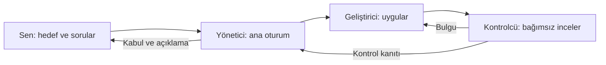
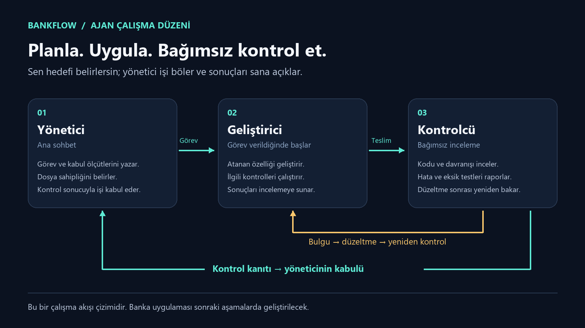

# BankFlow

**Banka içi transfer ve operasyon yönetimi için portföy projesi.** Hedef teknoloji: Java Spring Boot, React ve Oracle.

İlk aşama olan ajan sistemi, kısa hafıza ve VS Code çalışma alanı hazır. Banka uygulaması henüz geliştirilmedi. Bakiye, giriş ve transfer ekranları sonraki aşamalarda eklenecek.

Geliştirme numaralı hedeflerle ilerler: kullanıcı bir hedef seçer, ekip yalnız o hedefe kadar tamamlar ve kontrol kanıtlarını teslim eder. Önce proje tamamlanır; ayrıntılı öğretim ve mülakat hazırlığı daha sonra yapılır.

**Başlangıç belgesi:** [Proje hedefleri (PDF)](docs/BankFlow-Proje-Hedefleri.pdf) veya [metin sürümü](docs/HEDEFLER.md). Ortak depo: [berk-celikten/bankflow](https://github.com/berk-celikten/bankflow).

## Başlamak

1. `BankFlow.code-workspace` dosyasını VS Code ile aç.
2. Codex simgesini aç. Eklenti hesabına giriş isterse kendi hesabınla giriş yap. Bu işlem ajan dosyaları tarafından yapılmaz.
3. Proje güveni sorulursa dosyaları inceleyip kendi projen olarak güven kararını ver. Proje ayarları güvenilen klasörlerde yüklenir; bu teslim global güven ayarlarını değiştirmez.
4. Menüden **Terminal → Run Task** seç. `BankFlow: Çalışma alanını doğrula` ve `BankFlow: Ortamı kontrol et` görevlerini çalıştır.
5. [Görev panosunu](docs/GOREVLER.md) aç. Yönetici, geliştirici ve kontrolcü tanımları [ajan rehberinde](docs/AJAN-SISTEMI.md).

VS Code Codex sohbetine ilk mesaj olarak şunu yazabilirsin:

> Önce yalnız AGENTS.md ve memory/STATE.md dosyalarını oku. BankFlow yöneticisi olarak devam et. Kullanıcının seçtiği hedefteki ilgili görevi geliştiriciye ver, biten işi kontrolcüyle bağımsız kontrol et. Kabul ölçütleri ve test kanıtı olmadan görevi DONE yapma. Türkçe ve kısa açıklamalar yap.

Buradaki sohbetten de aynı proje üzerinde devam edebiliriz. VS Code'da açılan yeni sohbet ayrı bir oturumdur; proje dosyalarını okuyarak devam eder. Aynı dosyaları değiştiren iki yönetici oturumunu eşzamanlı çalıştırma.

## Üç rol



Ana oturum yöneticidir; geliştirici ve kontrolcü görev gerektiğinde başlatılır. Ajan dosyaları kendi başlarına çalışan servisler değildir. Bu kurulum sürekli arka planda çalışan bir otomasyon kurmaz. Bu teslimin hazırlanmasında gerçek altajanlar kullanılıyor; yeni VS Code oturumunda yerel rol keşfi ayrıca doğrulanmalıdır.

Kullanıcının doğrudan erişmesi için **BankFlow - Geliştirici** ve **BankFlow - Kontrolcü** adlı ayrı sohbetler de oluşturuldu. Bunlar aynı proje dosyaları üzerinde kendilerine atanan görevlerle çalışır. Altajan çalıştırması ile ayrı sohbet aynı şey değildir; sohbetler kendiliğinden birbirine mesaj göndermez.

## Kısa hafıza ve model seçimi

Başlangıçta yalnız `AGENTS.md` ile `memory/STATE.md` okunur. Kararlar `memory/DECISIONS.md`, oturum devri `memory/HANDOFF.md`, geçmiş kanıtlar `memory/archive/` içinde tutulur; bunlar gerektiğinde açılır. `node scripts/context-budget.mjs` uzunluk sınırlarını denetler. Gösterilen token sayısı kaba içerik tahminidir; sistem talimatları, araçlar ve geçmiş dahil gerçek tüketimi ölçmez.

| İş | Model / düşünme |
| --- | --- |
| Uygulama geliştirme | GPT-6.1 Sol / Medium |
| Rutin kontrol, dar kapsamlı yardımcı işler | GPT-6 Luna / High |
| Transfer, yetki, eşzamanlılık, onay incelemesi | GPT-6.1 Sol / High |

Yönetici, kritik inceleme görevinde modeli açıkça yükseltir. Kontrolcü rol dosyası model sabitlemez; rutin model proje ayarından devralınır. [Resmi model seçimi rehberi](https://learn.chatgpt.com/docs/model-selection).



## Kontrol komutları

VS Code görevleriyle aynı kontroller terminalden de çalışır:

```text
node scripts/verify-workspace.mjs
node scripts/check-environment.mjs
node scripts/check-environment.mjs --json
node scripts/context-budget.mjs
```

İlk komut çalışma alanı dosyalarını kontrol eder; banka uygulamasını test etmez. İkinci komut araçları bulur ve eksikleri raporlar; kurulum yapmaz. Java, Maven veya Docker eksikse ortam kontrolünün başarısız olması beklenen bir teşhistir.

## Projeyi hangi sırayla bitireceğiz?

[Aşama planı](docs/PLAN.md) → [görevler](docs/GOREVLER.md) → [tamamlandıktan sonraki öğrenme ve mülakat yolu](docs/OGRENME-YOLU.md).

Önce ekran tasarımı ve mimariyi görselleştireceğiz; sonra hesaplar, güvenli transfer, personel onayı ve denetim kayıtlarını tamamlayacağız. Her aşama kendi kabul ölçütleriyle kontrol edilecek.

## Yapı

```text
BankFlow/
  .codex/                 Projeye özel ajan tanımları
  .vscode/                Görevler ve eklenti önerileri
  docs/                   Plan, görev panosu, ajan ve öğrenme rehberi
  memory/                 Kısa güncel durum, kararlar ve oturum devri
  scripts/                Bağımlılıksız çalışma alanı/ortam kontrolleri
  AGENTS.md               Ajanların ortak çalışma kuralları
  BankFlow.code-workspace VS Code giriş dosyası
```

Uygulama aşamasında `backend/`, `frontend/` ve `infra/` eklenecek. Henüz bu klasörler için çalıştırma veya test sonucu yok.

## Yapılandırma kaynağı

Projeye özel `.codex/agents/*.toml` tanımları ve `[agents]` ayarları resmi [OpenAI altajan belgelerine](https://learn.chatgpt.com/docs/agent-configuration/subagents) göre hazırlanır. Proje ayarlarının güven koşulu [yapılandırma belgelerinde](https://learn.chatgpt.com/docs/config-file/config-basic) açıklanır. Hesap, model ve izin ayarları mevcut oturumdan devralınır.
